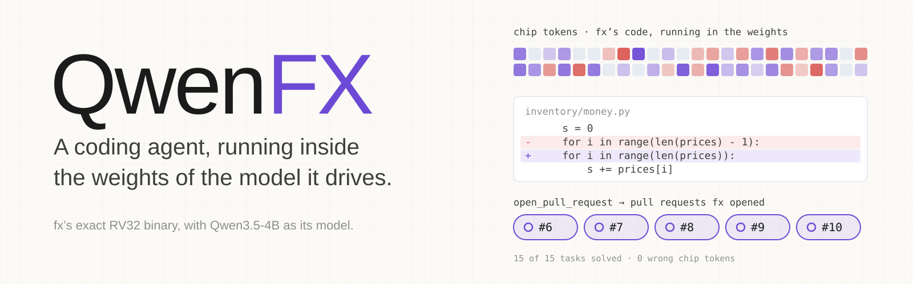

<p align="center">
  
</p>

Model: [Hugging Face](https://huggingface.co/divagr1925/QwenFX)  
Part of [Qwenputer](https://github.com/divagr18/qwenputer), the computer compiled into Qwen3.5's weights.

**QwenFX runs [fx](https://github.com/vercel-labs/fx), Vercel's coding agent, as its exact compiled
binary on the RISC-V CPU compiled into Qwen3.5-4B's weights, with that same Qwen as its model.
fx's own code runs on the CPU, token by token, and calls Qwen for every step. It solved 15 of 15
small coding tasks, each checked by a hidden test, and it opened five pull requests on GitHub
by itself: [#6](https://github.com/divagr18/fxputer-sandbox/pull/6),
[#7](https://github.com/divagr18/fxputer-sandbox/pull/7),
[#8](https://github.com/divagr18/fxputer-sandbox/pull/8),
[#9](https://github.com/divagr18/fxputer-sandbox/pull/9) and
[#10](https://github.com/divagr18/fxputer-sandbox/pull/10). Every chip token in every run was
checked against a reference machine. None was wrong.**

fx is an RV32IM+Zba ELF, 75.6 MB with symbols and 7 MB of code, built from fx's unmodified
source. The CPU it runs on is not learned: a compiler computes every weight. Qwen3.5-4B is base
Qwen, with its own weights.

## What it does

fx gets a GitHub issue and a repository. It reads files, greps, edits, and decides when the fix
is done. Then it calls one tool, `open_pull_request(title, body)`, and the host turns fx's file
store into a branch and a pull request.

| issue | pull request | solved on the PR branch | fx's title |
|---|---|---|---|
| [#1](https://github.com/divagr18/fxputer-sandbox/issues/1) total() gives the wrong sum | [#6](https://github.com/divagr18/fxputer-sandbox/pull/6) | yes | Fix total() function to include all prices in the sum |
| [#2](https://github.com/divagr18/fxputer-sandbox/issues/2) rename get_count | [#7](https://github.com/divagr18/fxputer-sandbox/pull/7) | yes | Rename Store.get_count to count |
| [#3](https://github.com/divagr18/fxputer-sandbox/issues/3) slugify | [#8](https://github.com/divagr18/fxputer-sandbox/pull/8) | yes | Add slugify(text) function to inventory/text.py |
| [#4](https://github.com/divagr18/fxputer-sandbox/issues/4) low stock 10 | [#9](https://github.com/divagr18/fxputer-sandbox/pull/9) | yes | Fix low stock threshold: fewer than 10 units (not 5) |
| [#5](https://github.com/divagr18/fxputer-sandbox/issues/5) parse_line whitespace | [#10](https://github.com/divagr18/fxputer-sandbox/pull/10) | yes | Fix parse_line to trim surrounding whitespace on names |

The tasks are P0c's: five bugs and features in a 10-file Python library, each with a hidden
check fx never sees. On the chip, with real Qwen3.5-4B:

- **15 of 15 solved** without units (5 tasks, 3 reps), and two two-turn runs.
- **15 of 15 solved** with the 13 hot-code units on, and **5 of 5** with Qwen's text going
  through the chip's text bridge.
- **One long session**: all five tasks as five turns of one fx session, solved, 15 steps.
- **5 of 5 pull requests**, one per issue, each passing its task's hidden check as GitHub serves
  the branch.

Three runs per task, and one per issue, on tiny tasks: they show the path works. They do not
measure a failure rate.

## How it works

- **fx as an RV32 binary.** fx is written in Zig and builds to WebAssembly. Its wasm core goes
  through wasm2c and `zig cc` to an RV32IM+Zba ELF. Every wasm import becomes an `ecall`.
  `fx/check_src.sh` checks fx's 717 source files against commit `757bdb9`: 0 changed.
- **The CPU in the weights.** `chipformer/rv/` compiles an RV32IM+Zba core into Qwen3.5's own
  layer types, Gated DeltaNet and SwiGLU. Registers, ROM and RAM live in the DeltaNet heads'
  recurrent state. fx's code runs at about 1.5 predicted tokens per instruction.
- **Paged memory.** fx needs 7 MB of code and megabytes of scattered writes. The paged map
  gives it 4,096 frames of 512 bytes, page tables and a 16 MB linear window, in 162 chip layers.
- **Executor v4.** One persistent CUDA kernel runs the chip's layers for a whole burst of tokens.
  It runs fx's code at about 24,000 chip tokens a second on one L4.
- **The chip file.** The circuit ships as `chip.safetensors`: the chip's nonzero weights in
  bf16, plus fx's boot state. Executor v4 lifts the circuit from the file's weights at load.
- **The I/O path.** At an `ecall` the chip stops. The host reads arguments and request bodies
  out of fx's memory through tokens the chip prints, and writes replies back through tokens it
  feeds. Nothing is poked into the machine's state after boot.
- **Qwen.** Base Qwen3.5-4B runs in HF transformers in the same process, on the same GPU. When
  fx sends a model request, the host renders it, Qwen generates, and the reply goes back to fx.
- **Units.** 13 fixed-function circuits for fx's hottest loops (memcpy and memmove, memset, a
  JSON string scan, eqlBytes, SHA-256 and others). Each fires at a fixed PC of this ELF and does
  the loop's work in fewer tokens.

## What runs where

- **In the model:** fx's code, all of it, from the boot snapshot to the end of the session: its
  agent loop, the requests it builds, its reading of the model's stream, and its own read, edit
  and write tools. The decision to open the pull request, the change, and the PR's title and body
  are produced in the model: Qwen generates them, and fx's code on the chip acts on them.
- **On the host:** chat-template rendering, tokenizing, and parsing Qwen's text into tool calls
  (a model server's job), the file store fx reads and writes through WASI, `grep_files` and
  `glob_files` (fx's versions do not compile for WASM), the import handlers (clock, random,
  environment), Qwen's state snapshots, the git and GitHub mechanics of the pull request, and
  the footer the host adds to each PR body.
- **Two weight sets, one process.** The chip and Qwen are two sets of weights on one GPU, not one
  merged checkpoint. A merged fx checkpoint would be about 35 GB (estimated) and was not built.
- **Boot.** fx's boot ran on rv32emu, a C emulator, to make the snapshot every run starts from.
  A separate run from reset proved boot on the chip: fx's recorded session with no snapshot,
  11.4M tokens, 0 wrong.
- **Units are specialised.** The 13 units fire at this ELF's PCs. Another build of fx would need
  them found again. With units on, the CPU no longer runs those loops instruction by instruction.
  A second emulator runs fx's original code beside it to check the results match.
- **The prompt asks for the PR.** The issue prompt ends with one sentence telling fx to open a
  pull request with the `open_pull_request` tool when the change is complete.

## Numbers

All measured on one NVIDIA L4 unless marked. Raw numbers are in `docs/fx/*.json`.

| | |
|---|---|
| Chip speed, fx's code, Executor v4 | 23,600-24,000 tokens/s with units; 25,800-26,100 without |
| Chip tokens per task, t1_bug | 3.45M with units; 5.25M without (3 model steps) |
| fx's recorded session (2 turns, 7 model calls) | 6.67M chip tokens with units; 10.51M without |
| The 13 units' saving, 15 live runs | 87.24M chip tokens against 133.69M for the same 71 steps: **34.7% fewer** |
| Task time, units on, 15 runs | median 249 s, range 156-759 s (chip, I/O, Qwen and host) |
| t1_bug from the chip file | 168 s: 146 s chip, 21 s Qwen, 1 s I/O; plus 174 s to load |
| The chip's share of a run's wall time | 77-95% without units; Qwen and the host are the rest |
| Chip file, 13 units | 124,960,497 bytes, 19.07M nonzero weights, 162 chip layers |
| Chip file, no units | 132,640,220 bytes, 20.66M nonzero weights, 161 chip layers |
| VRAM, base Qwen plus an fx chip file, after load | 8.74 GB allocated, 8,655 MiB in nvidia-smi (A10G, the 1,024-frame file) |
| VRAM peak in a live run | 9.5-13.6 GB without units, 14.0 GB with units |

## Quickstart

One Linux machine with one 24 GB NVIDIA GPU (L4 or A10G), `gcc`, `git` and
[uv](https://docs.astral.sh/uv/). Qwen3.5-4B takes 8.4 GB of disk. This path was checked from a
fresh clone on an L4.

```bash
git clone https://github.com/divagr18/QwenFX && cd QwenFX && uv sync --extra hf
uv run python qwenfx.py setup        # fx's ELF (sha256 checked), rv32emu, Qwen3.5-4B
uv run hf download divagr1925/QwenFX fx-live-u13-f4096.safetensors --local-dir chip
uv run python qwenfx.py task t1_bug  # fx fixes a bug on the chip; the hidden check runs at the end
```

The download is the chip file. `uv run python qwenfx.py chip` builds the same file from the Python
circuit instead and writes it to the same place. `task` runs fx on the chip with Qwen3.5-4B. It prints the result,
`"solved": true` and the check's answer, and writes the whole run to `runs/live/`. rv32emu runs
beside the chip in lockstep, and after the run every chip token is audited against the reference
machine. `--no-units` runs the circuit without the units. Any `live_chip.py` flag passes through,
such as `--reps 1 2 3` or `--no-audit`.

On a fresh clone on an L4 box with 16 vCPUs, with the test suite running beside it, `chip` took
3.4 minutes and 6.4 GB of RAM. `task t1_bug` took 9 minutes end to end and solved the task: 67 s
to load Qwen, 181 s to lift the chip file and plan the kernel, 168 s for fx's session (146 s on
the chip, 20 s in Qwen), and 21 s for the audit. It peaked at 10.1 GB of GPU memory and 9.1 GB
of RAM. The run's 3,448,213 chip tokens and its final repository are the same as `units-file.md`'s
run of the same task and seed.

### Issue in, pull request out

On a repository you own, with `gh auth login` done:

```bash
uv run python qwenfx.py seed ~/fx-sandbox                  # the inventory library, as a git repo
(cd ~/fx-sandbox && gh repo create YOU/fx-sandbox --private --source . --push)
uv run python qwenfx.py issues --repo YOU/fx-sandbox       # one issue per task
uv run python qwenfx.py pr 1 --repo YOU/fx-sandbox         # fx fixes issue #1 and opens a PR
```

The handler runs inside the driver, on 127.0.0.1. Its limits are in code:

- it writes to one repository, the one you name with `--repo` (or `QWENFX_REPO`); there is no
  default;
- it pushes only new branches named `fx/...`, with a plain push: no force push, never `main`;
- it opens at most one pull request per run, and nothing in it merges, closes or deletes;
- the token stays with `gh`. It is never in the job, the prompt, Qwen's context or a log.

Commits use `--author "Name <email>"`, or your git config. When the run ends, the driver runs the
task's hidden check on the PR branch as GitHub serves it.

To try the flow with no GitHub at all, `uv run python qwenfx.py pr-local t1_bug` runs the same
driver and handler against a local bare repository and a fake PR call. On the same fresh clone,
fx called `read_file`, `edit_file` and `open_pull_request`, with the same title as
[#6](https://github.com/divagr18/fxputer-sandbox/pull/6). The handler pushed `fx/issue-1-local`
with the one-line fix, `main` did not move, the hidden check passed on the branch, and the audit
found 0 wrong tokens in 5.15M.

## Checks

- **0 wrong chip tokens.** After every run, the whole token stream goes through the reference
  machine (`PagedMachine`). Over the 17 live runs without units: 149.7M chip tokens, 0 wrong.
  The 15 runs with units: 89.4M, 0 wrong. The 5 pull-request runs: 65.7M, 0 wrong.
- **Lockstep emulators.** rv32emu runs beside the chip on the same model replies. At every
  `ecall` the PC, all 31 registers and the instruction count must match, and every request body
  must match byte for byte. At the end, the host I/O hash chain, the final repository and every
  page rv32emu changed must match too. With units on, a second rv32emu runs fx's original code,
  and only registers dead by the ABI and dead stack words below `sp` may differ.
- **fx unchanged.** `fx/check_src.sh` finds 717 files, 0 changed against `757bdb9`. The ELF's
  sha256 is `282e53d4…` in every run file.
- **The chip file is the circuit.** Lifted from the file, the circuit equals the Python build
  head for head and unit for unit, plans the same 14 executor phases, and runs fx's recorded
  session (6,666,925 tokens) with 0 wrong.
- **Tests.** `uv sync --extra hf --extra wasm && uv run pytest` runs the suite: the core against
  riscv-tests and C programs, the paged memory, the units, the chip file, the live I/O protocol
  and the PR handler. The GPU tests run when a GPU is there. The whole-session PR test also needs
  `FXPR_ELF`, `FXPR_DLL` and `FXPR_MODEL`, set to `build/fx-fastcopy.elf`, `build/rv32emu.so` and
  Qwen3.5-4B's directory. On a fresh clone on an L4: 444 passed and 26 skipped in 84 minutes, and
  the whole-session PR test passed on its own in 14 minutes. The skips are long traces behind
  `RV_SLOW=1`, programs the executor checks free-running instead, that whole-session test, and
  one test that needs Qwenputer's rv-q4p2 chip file.

| | |
|---|---|
| Agent | fx 0.0.16, [vercel-labs/fx](https://github.com/vercel-labs/fx) at `757bdb9`, source unchanged |
| Binary | RV32IM+Zba ELF, 75.6 MB, sha256 `282e53d4…`, in `third_party/fx/` (xz, 13.9 MB) |
| Model | [Qwen/Qwen3.5-4B](https://huggingface.co/Qwen/Qwen3.5-4B), its own weights unchanged |
| CPU | RV32IM + Zba in Gated DeltaNet and SwiGLU layers; 162 chip layers with fx's memory map |
| Memory | 4,096 frames of 512 B, page tables, a 16 MB linear window; ROM for 7 MB of code |
| Executor | Executor v4: one persistent CUDA kernel, compiled with NVRTC, 14 phases per step |
| Chip file | 125 MB safetensors: 19.07M nonzero bf16 weights and fx's boot state |
| Sampling | temperature 1, no top-k or top-p, as P0c's vLLM defaults; the seed is the rep |

## The write-ups

Each is marked measured (M) or estimated (E) throughout, in `docs/fx/`:

- `p0-report.md`, `p0c-report.md`: fx's size and cost on RV32; base Qwen driving native fx.
- `speed-iter.md`, `speedups.md`: turn 1 from 32.5M to 5.65M instructions, fx's code unchanged.
- `exec-v4.md`: the persistent kernel. `memory.md`: the paged map.
- `circuits.md`, `circuits2.md`, `one.md`: the hot-code units, frames and long sessions.
- `io.md`, `live.md`: the packet path, then fx live on the chip with real Qwen.
- `chipfile.md`, `units-file.md`: the chip as a file, and the units as weights.
- `fwd.md`: the text bridge and a plain forward. `pr.md`: issue in, PR out.

`docs/rv32.md` is the RV32 core's design, from Qwenputer.

## Building fx's ELF yourself

The ELF in `third_party/fx/` is built from fx's unmodified source by the route in `fx/zbuild` and
`fx/rv`, with Zig 0.17.0 and wabt 1.0.42. `zig build` in `fx/zbuild` builds fx's wasm core with
fx's own module graph and build options. Its root, `rv_tools_main.zig`, is ours: it imports fx's
`wasm_core_main.zig` unchanged and adds one export that runs fx's read, edit and write tools in
the guest. `fx/zbuild/zig-lib-wasi-platform.patch` patches Zig's WASI libc and std (permission
bits), not fx. `fx/rv/build.py` then runs wasm2c and `zig cc` for riscv32. The steps are in
`docs/fx/speed-iter.md` (Reproduce), and `third_party/fx/NOTICE` lists what the ELF contains.

## Citing

Author: [Divyansh Agrawal](https://orcid.org/0009-0003-0739-2473) (ORCID: [0009-0003-0739-2473](https://orcid.org/0009-0003-0739-2473)).

GitHub's "Cite this repository" button reads [CITATION.cff](CITATION.cff). There is no DOI yet.

```bibtex
@software{agrawal2026qwenfx,
  author  = {Agrawal, Divyansh},
  title   = {{QwenFX}: a coding agent running inside the weights of the model it drives},
  year    = {2026},
  url     = {https://github.com/divagr18/QwenFX},
  license = {MIT},
  note    = {Author ORCID: https://orcid.org/0009-0003-0739-2473}
}
```

## Credits

[fx](https://github.com/vercel-labs/fx) is by Vercel (Apache-2.0). The base model is
[Qwen/Qwen3.5-4B](https://huggingface.co/Qwen/Qwen3.5-4B) (Apache-2.0). The ELF is built with
[Zig](https://ziglang.org) and wabt's [wasm2c](https://github.com/WebAssembly/wabt).

## License

The code is MIT. fx's ELF, its import table and the other fx-derived files are Apache-2.0, as
fx is: see [`third_party/fx/`](third_party/fx/) for fx's LICENSE, its third-party notices and our
NOTICE. A chip file carries fx's boot image in its state, so it falls under the same terms.
Qwen3.5-4B is not redistributed here: `setup` downloads it from Qwen's repository.
